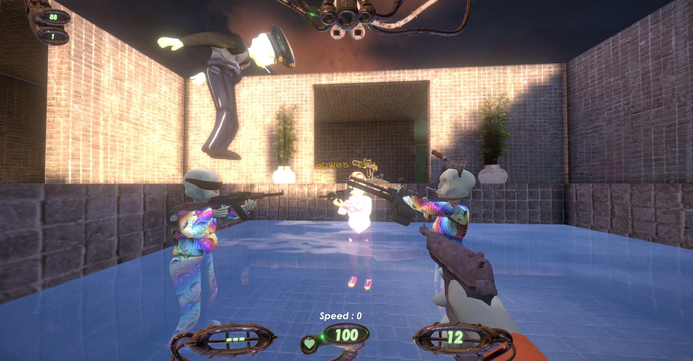

# moreStrafts Mod

A mod that extends Straftat's multiplayer lobby max capacity from 4 players to **10 players**.

---

## Installation

Drop `MoreStrafts.dll` into `BepInEx/plugins/`.

**Requires:** BepInEx 5.4.21+

## Usage

In the main menu, select your desired player count (2-10) from the **Max Players** dropdown before clicking Host. Do not change this setting after the lobby is created.

### Quick Load

Enable the **Quick Load** checkbox in the lobby (host only) to skip the post-round screen. Recommended for 5+ player lobbies.

### Logging

The mod writes a short per-instance log to `BepInEx/moreStrafts_debug/` include these files in bug reports. Enable via `Debug.PerInstanceLogFiles` in `BepInEx/config/com.nitrogenia.morestrafts.cfg`.

### Recommended Addon
For a better UI experience, install [MoreStrafts UISpawnAddon by Yeastmans](https://thunderstore.io/c/straftat/p/Yeastmans/MoreStrafts_UISpawnAddon/).

### Known UI Limitations

- Lobby preview shows only 4 player 3D models (players 5-10 get no preview character).
- Players 5-10 stack below the 4th slot in the lobby player list
- End-round screen and match points HUD (Tab) display up to 4 players/teams
- All players in the lobby need the same mod version

[Full changelog](https://github.com/ALBINALSHAIKH/moreStrafts/releases)

## Credits

[Report issues](https://github.com/ALBINALSHAIKH/moreStrafts/issues)